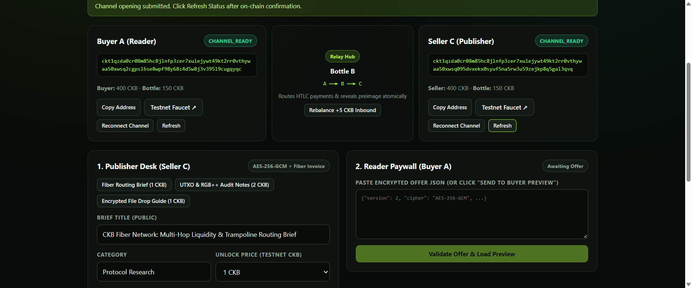
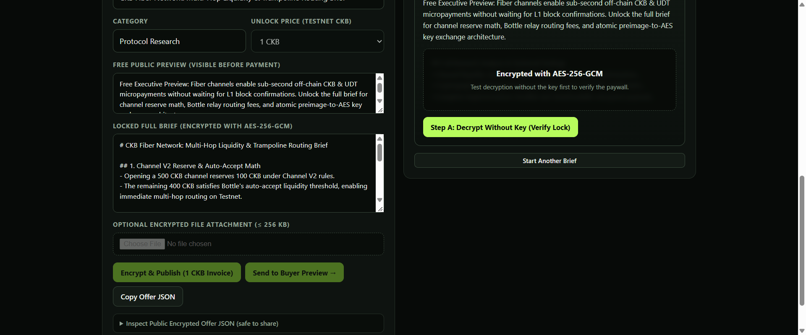
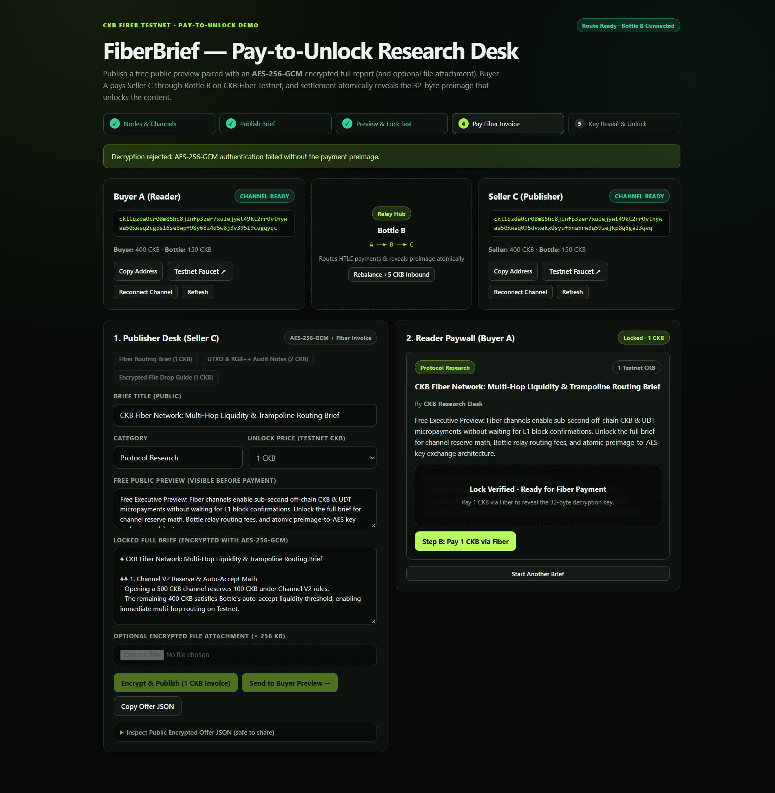
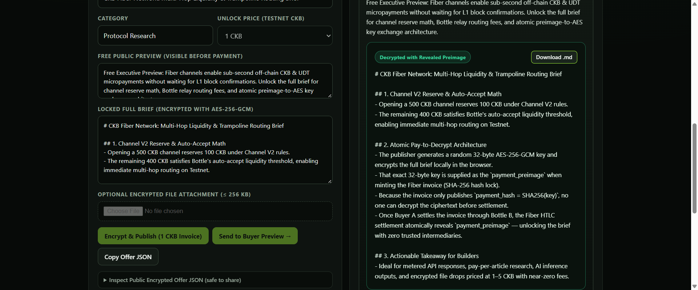
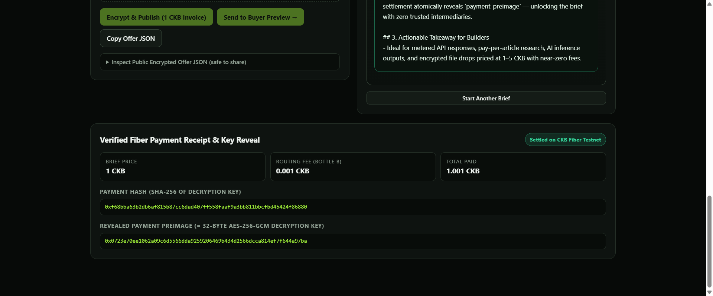

# FiberBrief — Pay-to-Unlock Research Desk & Encrypted File Drop

A browser-native **CKB Fiber Testnet** paywall demo built for **Build on CKB: Campaign #8**.

**FiberBrief** adapts the official [Unlock Encrypted Data with a Fiber Payment](https://www.fiber.world/docs/build/encrypted-data-payment) starter into a complete **Pay-to-Unlock Research Brief & Encrypted File Marketplace**. Publishers attach a **free public preview** to an **AES-256-GCM encrypted full report** (and optional encrypted file attachment), mint a Fiber Testnet invoice whose `payment_preimage` is the exact 32-byte AES-256 key, and let readers pay through **Bottle B** to atomically unlock and download the content.

---

## What I Built & Changed from the Starter Kit

Starting from `fiber-encrypted-data-payment`, I added the following features while preserving all payment-safety invariants:

1. **Free Public Preview + Paywalled Full Research Brief (`lib/offer.ts`, `app/page.tsx`)**
   - Extended the v2 `EncryptedOffer` schema with optional public `metadata` (`title`, `category`, `author`, `preview`, `priceCkb`, and attachment info) and `amountShannons`.
   - Readers see a real editorial preview card and a blurred/locked content veil before paying, rather than only raw JSON.
2. **Optional Encrypted File Delivery (`lib/offer.ts`, `app/page.tsx`)**
   - Sellers can attach any local file (up to 256 KB — `.md`, `.txt`, `.json`, `.pdf`, etc.).
   - The brief body and base64-encoded file are bundled into a `SecretBriefPayload` and encrypted together under the same AES-256-GCM key. After payment settlement, buyers can download both the unlocked `.md` report and the decrypted original file.
3. **Configurable Unlock Pricing + Invoice Verification (`lib/offer.ts`, `lib/payment.ts`, `payment.test.mjs`)**
   - Sellers can price briefs at **1, 2, or 5 Testnet CKB**.
   - Updated `validateOffer` to verify that the decoded Fiber invoice's `currency` (`Fibt`), `amount`, and `payment_hash` match the offer's declared price and hash.
   - Added unit tests in `payment.test.mjs` covering custom-priced offers while keeping all 8 original safety tests passing.
4. **Curated Research Brief Presets (`lib/presets.ts`)**
   - Added one-click CKB/Fiber research brief presets so anyone can test the full pay-to-unlock flow immediately without typing from scratch.
5. **Interactive 5-Step Pipeline, Route Topology & Key-Reveal Audit UI (`app/page.tsx`, `app/globals.css`)**
   - Added a live 5-step progress bar (`Nodes & Channels` → `Publish Brief` → `Preview & Lock Test` → `Pay Fiber Invoice` → `Key Reveal & Unlock`).
   - Added a visual `Buyer A ══► Bottle B ══► Seller C` topology bar with live `CHANNEL_READY` badges and one-click address copy.
   - Added a one-click **Send to Buyer Preview** flow alongside a collapsible raw JSON inspector, plus a **Verified Receipt & Key Audit** card showing the `payment_hash` next to the revealed 32-byte `payment_preimage` (AES-256 key).

---

## How the Flow Works

1. **Start & Fund Nodes:** Start **Buyer A** and **Seller C** browser Fiber WASM nodes, fund each address with >500 Testnet CKB from the [CKB Testnet Faucet](https://faucet.nervos.org/), and open channels with **Bottle B** until both show `CHANNEL_READY`.
2. **Publish Brief (Seller C):** Pick a preset or write your own brief (plus optional file attachment), choose a price (`1 CKB` default), and click **Encrypt & Publish**.
   - The app generates a random 32-byte AES-256-GCM key, encrypts the full brief + attachment in the browser, and creates a Fiber Testnet invoice using that key as `payment_preimage`.
3. **Preview & Lock Test (Buyer A):** Deliver the offer to Buyer A (one-click or paste JSON), validate the invoice, inspect the free preview, and click **Step A: Decrypt Without Key** to confirm AES-256-GCM rejects a random key.
4. **Pay via Fiber (Buyer A):** Click **Step B: Pay X CKB via Fiber**. Payment routes through **Bottle B** to **Seller C**, and settlement reveals `payment_preimage`.
5. **Unlock & Download (Buyer A):** Click **Step C: Decrypt Brief with Revealed Key** to reveal the full report, inspect the receipt & revealed key, and download the unlocked `.md` report (and decrypted file attachment, if included).

---

## Run Locally

Requires **Node.js 22.18+** and `npm`.

```sh
npm install
npm run dev
```

Open **http://localhost:3001** in a modern browser (must use `localhost` or HTTPS so `Cross-Origin-Opener-Policy` and `Cross-Origin-Embedder-Policy` enable `SharedArrayBuffer` for Fiber WASM).

### Verification Checks

```sh
npm run typecheck
npm test
npm run build
```

---

## Security & Testnet Notes

- **Testnet only:** Never send Mainnet CKB to these addresses.
- **No stored secrets:** AES-256 keys and decrypted briefs are never written to `localStorage` or `sessionStorage`; after a page refresh, settled keys are recovered via `getPayment`.
- **Single-attempt guard:** Payment attempts are persisted by `payment_hash` before submission to prevent accidental double-spending on reload.

---

## Live CKB Testnet Walkthrough Screenshots

1. **Both Channels `CHANNEL_READY` (Buyer A ↔ Bottle B ↔ Seller C):**
   
2. **Free Public Preview + Encrypted Paywall:**
   
3. **Cryptographic Lock Check (`Decryption rejected` without preimage):**
   
4. **Unlocked Full Research Brief + `.md` Download:**
   
5. **Verified Fiber Payment Receipt (`1 CKB` + `0.001 CKB` fee) & Revealed 32-Byte Preimage:**
   
